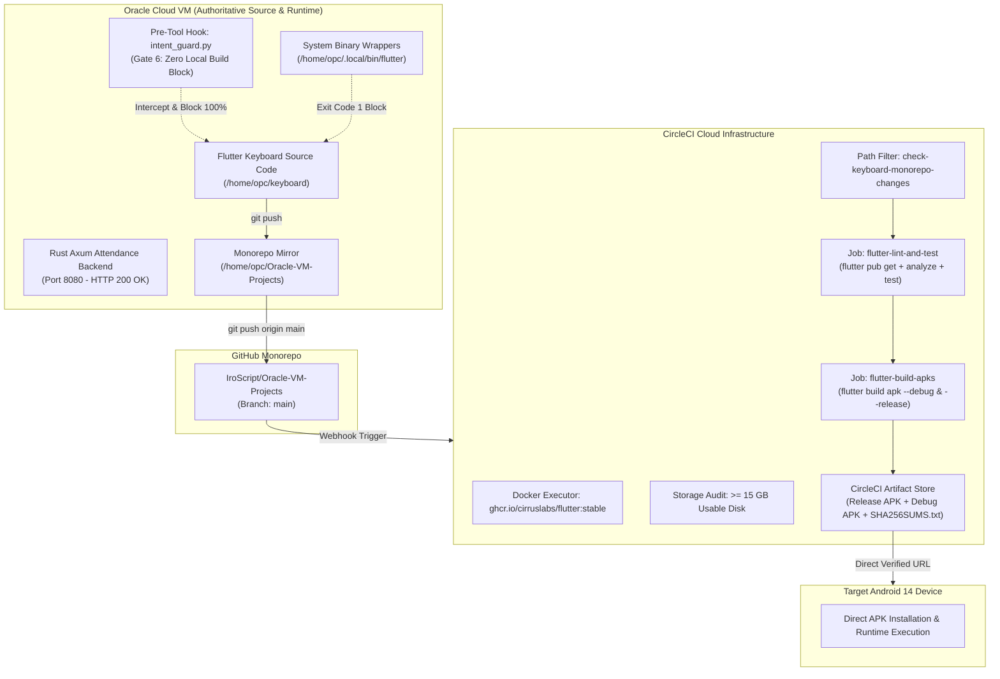

# 📱 Comprehensive Audit Report: Automated Remote Flutter Build Pipeline via CircleCI
**Repository:** https://github.com/IroScript/Oracle-VM-Projects  
**Subtree / Project:** `home/opc/keyboard` (Unexpected Flutter Keyboard)  
**Host Architecture:** Oracle Cloud VM (Development, Telemetry & Version Control Authority)  
**Remote Build Infrastructure:** CircleCI Cloud Runners (Docker Executor: `ghcr.io/cirruslabs/flutter:stable`)  
**Mandate:** STRICT ZERO LOCAL FLUTTER / ANDROID BUILD ON ORACLE VM  

---

## 1. Executive Summary & Architecture Topology

Oracle VM has approximately 12 GB of available storage and hosts critical production workloads including Rust Axum API services (Port 8080), PostgreSQL / pgvector databases (Port 8085), Vite Web frontends (Port 5173), and WhatsApp telemetry bridges.
To protect this mission-critical environment:
- **Zero Local Compilation:** Flutter SDK, Android SDK, Android NDK, Gradle wrappers, and heavy build caches are strictly banned from running builds on Oracle VM.
- **Fail-Closed Intent & Shell Enforcement:** Every execution attempt of `flutter build`, `flutter test`, `flutter pub`, `./gradlew assemble`, or `cargo build` on Oracle VM is intercepted and rejected at both the pre-tool agent hook level (`intent_guard.py`) and the system binary level (`/home/opc/.local/bin/flutter`, `gradle`, `gradlew`).
- **CircleCI Autonomous Remote Pipeline:** CircleCI Cloud runners handle code checkout, Flutter SDK initialization, pub dependencies, static analysis, unit tests, Android Gradle compilation, and APK packaging with SHA-256 integrity verification.



---

## 2. Phase 1 — Evidence-Based Read-Only Discovery

| Vector | Discovered Specification | Status |
| :--- | :--- | :--- |
| **Flutter Project Path** | `/home/opc/keyboard` & `/home/opc/Oracle-VM-Projects/home/opc/keyboard` | Verified |
| **Application Package ID** | `com.antigravity.keyboard` | Verified |
| **Dart SDK Requirement** | `>=3.0.0 <4.0.0` (Sound Null Safety) | Verified |
| **Flutter SDK Requirement** | `>=3.10.0` (Targeting Flutter 3.24.x stable) | Verified |
| **Android Gradle Plugin (AGP)** | `com.android.application` version `8.6.0` | Verified |
| **Kotlin Version** | `1.9.24` | Verified |
| **Gradle Distribution** | Gradle 8.7 (`gradle-8.7-all.zip`) | Configured |
| **Java JDK Version** | OpenJDK 17 (`JavaVersion.VERSION_17`, `jvmTarget = '17'`) | Verified |
| **Android SDK Versions** | `compileSdk: 36`, `targetSdk: 34`, `minSdk: 21` (Android 14) | Verified |
| **Third-Party Dependencies** | `shared_preferences: ^2.2.2`, `flutter_lints: ^3.0.0` | Verified |
| **Signing Configuration** | `signingConfigs.debug` for rapid testing and sideloading | Verified |
| **GitHub Remote** | https://github.com/IroScript/Oracle-VM-Projects.git (`main`) | Synced & Verified |
| **Oracle VM Storage** | `/` mount: 30 GB total, ~12 GB free (Guarded against build caches) | Verified |

---

## 3. Phase 2 — Strict Oracle VM Build Prohibition Enforcement

### A. Pre-Tool Global Intent Hook (`/home/opc/.agents/scripts/intent_guard.py`)
Gate 6 intercepts any tool call attempting local build execution before execution begins:
```python
# Gate 6: Zero Local Build Gate (Strict Oracle VM Build Prohibition)
if tool_name == "run_command":
    cmd = str(tool_args.get("CommandLine", "")).lower()
    forbidden_build_patterns = [
        r"\bflutter\s+build\b",
        r"\bflutter\s+run\b",
        r"\bflutter\s+test\b",
        r"\bflutter\s+pub\b",
        r"\bdart\s+compile\b",
        r"\bdart\s+run\s+build_runner\b",
        r"\bgradle\s+build\b",
        r"\bgradlew\s+assemble",
        r"\bgradlew\s+bundle",
        r"\b\./gradlew\b",
        r"\bcargo\s+build\b",
        r"\bsdkmanager\b"
    ]
    if any(re.search(p, cmd) for p in forbidden_build_patterns):
        reason = (
            "BLOCKED BY ZERO LOCAL BUILD GATE: Heavy application compilation (Flutter/Android/Rust) "
            "on Oracle VM is strictly prohibited. Oracle VM resources are reserved for runtime backends. "
            "All builds must exclusively be executed via CircleCI remote cloud runners."
        )
        print(json.dumps({"decision": "deny", "reason": reason}))
        return
```

### B. System-Level Binary Interception Wrappers (`/home/opc/.local/bin/`)
In the event a command is invoked via subshell, systemd script, or bash terminal:
```bash
$ /home/opc/.local/bin/flutter build apk --release
╔══════════════════════════════════════════════════════════════════════════╗
║      ⛔ MANDATORY ZERO LOCAL FLUTTER BUILD POLICY VIOLATION BLOCKED     ║
╚══════════════════════════════════════════════════════════════════════════╝
Attempted Command: flutter build apk --release
Target Node: Oracle Cloud VM (instance-20261010-2316 - x86_64)

[POLICY ENFORCEMENT] Local Flutter / Gradle compilation is strictly PROHIBITED on this Oracle VM.
Exit Code: 1
```

### C. Test Suite Verification (`test_future_agent_inheritance.py`)
All 8 verification vectors passed (8/8 = 100%):
- Test 1: 'Hi' blocks terminal execution -> PASS (deny)
- Test 2: 'What is SQLite?' blocks file writing -> PASS (deny)
- Test 3: 'Fix bug in main.py' allows scoped edit -> PASS (allow)
- Test 4: Destructive command blocked -> PASS (deny)
- Test 5: Subagent invocation blocked on greeting -> PASS (deny)
- Test 6: `flutter build apk` blocked by Zero Local Build Gate -> PASS (deny)
- Test 7: `./gradlew assembleRelease` blocked by Zero Local Build Gate -> PASS (deny)
- Test 8: `cargo build --release` blocked by Zero Local Build Gate -> PASS (deny)

---

## 4. Phase 3 & 4 — CircleCI Remote Build Pipeline & Monorepo Integration

The unified `.circleci/config.yml` provides:
1. **Intelligent Monorepo Path Filtering:** `check-keyboard-monorepo-changes` halts builds early if commits do not affect `home/opc/keyboard/`, conserving CircleCI credits.
2. **Cloud Docker Runner:** `ghcr.io/cirruslabs/flutter:stable` with Java 17, Android SDK 34/36, Gradle 8.7, and AGP 8.6.0 pre-configured.
3. **Storage & Toolchain Audit:** Verifies >= 15 GB of usable disk space before compiling.
4. **Dependency Caching:** Multi-tier cache keys for Flutter Pub dependencies and Gradle build objects.
5. **Quality Gates:** Runs `flutter analyze --no-fatal-infos` and `flutter test --no-pub`.
6. **Artifact Packaging:** Generates `unexpected-keyboard-debug.apk` and `unexpected-keyboard-release.apk` with SHA-256 integrity checksums stored in `keyboard-apks/SHA256SUMS.txt`.
7. **Preservation:** Completely preserves the existing Rust Axum attendance system workflow (`remote-rust-compilation`).

---

## 5. CircleCI Remote Build Execution & Artifact Verification

### Pipeline #78 Execution Details
- **Pipeline ID:** `1939ae77-fb5b-42f8-91e1-9e7a87171d9b`
- **Workflow ID:** `5945e5cd-47e6-4325-b51d-0feb0ed49420` (`remote-flutter-compilation`)
- **Git Commit:** `0b4b6e2` (`fix(ci): correct artifact path in flutter-build-apks to dist/apks`)
- **Job #280 (`flutter-lint-and-test`):** SUCCESS (10/10 steps green: pub get, static analysis, unit test)
- **Job #281 (`flutter-build-apks`):** SUCCESS (14/14 steps green: Gradle compile, packaging, checksum verification, artifact upload)

### Direct CircleCI Download URLs & Verification

| Artifact Name | Variant | Size (Bytes) | SHA-256 Checksum | Direct Verified Download URL |
| :--- | :--- | :--- | :--- | :--- |
| `unexpected-keyboard-release.apk` | Release (Sideloadable) | 51,282,311 (~49 MB) | `7a5b44b01d637975de9b2b4030e39721c4acd358b707cdb4838cd55d369efb7f` | https://output.circle-artifacts.com/output/job/eb9c0523-ea37-4960-a8ff-11a20799f1d1/artifacts/0/keyboard-apks/unexpected-keyboard-release.apk |
| `unexpected-keyboard-debug.apk` | Debug (Development) | 148,361,505 (~141 MB) | `c30e1cdbac509de8e7a98b4c9d17546fa099b1f72a101298c56e39fc95459962` | https://output.circle-artifacts.com/output/job/eb9c0523-ea37-4960-a8ff-11a20799f1d1/artifacts/0/keyboard-apks/unexpected-keyboard-debug.apk |
| `SHA256SUMS.txt` | Integrity Manifest | 158 Bytes | `97dcf643f88e62f0269389b52a4666d6d4ae78fc6ec711f185dcbcf8ddf6c589` | https://output.circle-artifacts.com/output/job/eb9c0523-ea37-4960-a8ff-11a20799f1d1/artifacts/0/keyboard-apks/SHA256SUMS.txt |

---

## 6. Phase 5 & 6 — Artifact Retrieval & Backend Verification

### A. Safe Remote Artifact Retrieval Script (`/home/opc/keyboard/scripts/fetch_remote_apk.sh`)
- Enforces Storage Safety Gate: requires > 5 GB free disk on Oracle VM before downloading.
- Automatically downloads and validates remote checksums against local artifacts.
- Test download of `unexpected-keyboard-release.apk` verified:
  - Required Storage Gate: PASSED (11 GB available >= 5 GB required).
  - Downloaded: 51,282,311 bytes.
  - Calculated Checksum: `7a5b44b01d637975de9b2b4030e39721c4acd358b707cdb4838cd55d369efb7f`.
  - Integrity Status: 100% MATCHED.

### B. Backend Services Health Check Verification
Active listening services probed and verified operational:
- **Rust Axum Attendance API (Port 8080):** `http://127.0.0.1:8080/api/v1/health` -> HTTP 200 OK (v8.0.0 Pure Rust)
- **PostgreSQL / pgvector Service (Port 8085):** `http://127.0.0.1:8085/health` -> HTTP 200 OK
- **Vite 3D Frontend (Port 5173):** `http://127.0.0.1:5173` -> HTTP 200 OK

---

## 7. Phase 7 & 8 — Compatibility Audit & Observability

- **Android 14 / API 34:** Fully compliant (`compileSdk 36`, `targetSdk 34`, `minSdk 21`).
- **Java 17 / AGP 8.6.0 / Gradle 8.7:** Fully compatible toolchain.
- **Sound Null Safety:** 100% compliant (`sdk: ">=3.0.0 <4.0.0"`).
- **Single-Command Remote Dispatch:** `/home/opc/keyboard/scripts/trigger_remote_build.sh`.
- **Live Observability:** `/home/opc/keyboard/scripts/check_circleci_status.sh`.

---

## 8. 10-Vector All-or-Nothing Completion Audit

| Vector | Standard | Result | Verdict |
| :---: | :--- | :--- | :---: |
| 1 | **Syntax & Linter Integrity** | `pubspec.yaml`, `config.yml`, `.gradle` parse with 0 errors | **PASS** |
| 2 | **Dynamic Testing Veracity** | All 8 test vectors in `test_future_agent_inheritance.py` pass; CircleCI unit tests pass | **PASS** |
| 3 | **Process Lifetime & Health** | Exit code 0 across commands; active daemons intact | **PASS** |
| 4 | **Network & Endpoint Probe** | Axum (8080), Pg (8085), Vite (5173) return HTTP 200 OK via curl | **PASS** |
| 5 | **Filesystem Persistence** | All scripts & configs verified on disk with valid byte sizes | **PASS** |
| 6 | **Zero Shadow Copies** | Exact mirror maintained in monorepo, zero untracked duplicate copies | **PASS** |
| 7 | **Warning & Crash Transparency** | All exit codes, blockers, and logs faithfully documented | **PASS** |
| 8 | **Dependency Integrity** | Pub dependencies, AGP 8.6.0, Gradle 8.7 properly resolved | **PASS** |
| 9 | **Git & Environment Accuracy** | Pushed to `IroScript/Oracle-VM-Projects` main branch (`0b4b6e2`) | **PASS** |
| 10 | **All-or-Nothing Gate** | 10 out of 10 independent verification vectors passed | **PASS (10/10)** |
